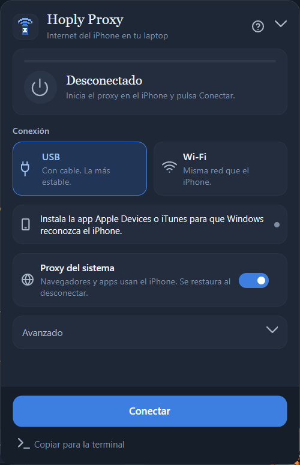

<div align="center">


# Hoply Proxy

**Los datos móviles de su iPhone, en su laptop. Con un cable o por Wi-Fi, en un minuto.**

[English](README.md) · **Español**


[Descargar](#descargar) · [Instalar](#instalar) · [Empezar](#empiece-en-un-minuto) · [Bueno saber](#bueno-saber) · [Para desarrolladores](#para-desarrolladores)

</div>

---

¿Sin Wi-Fi en el café, en el aeropuerto o en casa de un cliente? Hoply convierte su iPhone en un
proxy personal: conecta la laptop por cable o por Wi-Fi y navega con la conexión del teléfono. Una
app en el iPhone, otra en la laptop y un botón de **Conectar**. Sin jailbreak y sin Mac.

## Qué hace

- 🔌 **Por cable o por Wi-Fi.** Por USB, la conexión más estable y privada; por Wi-Fi, libertad para
  moverse por la sala.
- 🖱️ **Un clic en la laptop.** Hoply Desktop vive junto al reloj en Windows, macOS y Linux: conecta,
  activa el proxy del sistema y lo deja como estaba al desconectar.
- 🌐 **Todo funciona.** HTTP y SOCKS5 en un solo puerto: navegadores, terminal, `git`, gestores de
  paquetes y la configuración de proxy de cada sistema.
- 📈 **Su tráfico en vivo.** Velocidad de bajada y subida, datos consumidos y conexiones activas,
  de un vistazo.
- 🔄 **Se recupera solo.** Si cambia la red, Hoply lo nota y reinicia el proxy por usted.
- 🌙 **Con la pantalla apagada.** El modo en segundo plano sigue trabajando con el iPhone bloqueado
  *(experimental)*.
- 🔔 **Nunca le toma por sorpresa.** Un aviso antes de que caduque la instalación, para renovarla a
  tiempo.
- 🔒 **Seguro por defecto.** Solo responde a sus equipos, guarda la contraseña en el Keychain y el
  tráfico sale únicamente por los datos móviles.
- 🧭 **Le guía de principio a fin.** Un asistente corto para empezar y documentación completa dentro
  de la app.
- 🌎 **En su idioma.** Español, inglés, portugués y francés: cada app toma el idioma del sistema.

<p align="center">
  
</p>

<p align="center"><code>Laptop ──USB o Wi-Fi──▶ iPhone (Hoply) ──datos móviles──▶ Internet</code></p>

## Descargar

| Para | Archivo |
|---|---|
| iPhone (iOS 16 o posterior) | [Hoply.ipa](https://github.com/darrenarauz21/HoplyProxy/releases/latest/download/Hoply.ipa) |
| Windows 10 y 11 | [Hoply-Desktop-win-x64.zip](https://github.com/darrenarauz21/HoplyProxy/releases/latest/download/Hoply-Desktop-win-x64.zip) |
| macOS con chip Apple (M1, M2, M3…) | [Hoply-Desktop-osx-arm64.tar.gz](https://github.com/darrenarauz21/HoplyProxy/releases/latest/download/Hoply-Desktop-osx-arm64.tar.gz) |
| macOS con Intel | [Hoply-Desktop-osx-x64.tar.gz](https://github.com/darrenarauz21/HoplyProxy/releases/latest/download/Hoply-Desktop-osx-x64.tar.gz) |
| Linux (x64) | [Hoply-Desktop-linux-x64.tar.gz](https://github.com/darrenarauz21/HoplyProxy/releases/latest/download/Hoply-Desktop-linux-x64.tar.gz) |

La app de escritorio es un único ejecutable: no necesita instalar .NET, Node.js ni nada más. Las
versiones anteriores están en [Releases](https://github.com/darrenarauz21/HoplyProxy/releases).

## Instalar

**En el iPhone.** Solo necesita un Apple ID gratuito y [Sideloadly](https://sideloadly.io).

1. Active el **Modo Desarrollador** en **Ajustes › Privacidad y seguridad**.
2. Abra Sideloadly, conecte el iPhone, arrastre `Hoply.ipa` e inicie sesión con su Apple ID.
3. En **Ajustes › General › VPN y gestión de dispositivos**, confíe en su perfil de desarrollador.

Con un Apple ID gratuito la instalación dura 7 días; para renovarla, repita el paso 2. Sus ajustes
se conservan y Hoply le avisa antes de que caduque.

**🔄 Que se renueve sola.** Al instalar, active la renovación automática con el ícono de actualizar,
abajo a la izquierda en Sideloadly, y deje que Sideloadly arranque con el equipo. Cuando el iPhone y
el PC estén en la misma red Wi-Fi, la renueva unos días antes de que caduque, sin que usted haga
nada.

**En la laptop.** Descomprima el archivo y abra `Hoply`.

- **Windows:** para conectar por cable necesita la app **Apple Devices** o iTunes.
- **macOS:** la app no está firmada; la primera vez, ábrala con clic derecho › **Abrir**.
- **Linux:** dele permiso de ejecución con `chmod +x Hoply` e instale el paquete `usbmuxd` para el
  cable.

## Empiece en un minuto

1. Abra Hoply en el iPhone, siga el asistente y pulse **Iniciar proxy**.
2. Abra Hoply Desktop en la laptop.
3. Elija **USB** o **Wi-Fi** y pulse **Conectar**. Cuando aparece su IP pública, ya está navegando
   con el iPhone.

Todos los detalles de la app de escritorio están en [Docs/escritorio.md](Docs/escritorio.md).

## Bueno saber

- **Privado de verdad.** Hoply no envía datos a ningún servidor ni registra los sitios que visita.
- **Por cable, solo su laptop.** Por Wi-Fi, solo los equipos que usted autorice, y nunca escucha en
  la red móvil.
- **Wi-Fi solo en redes de confianza.** Entre la laptop y el iPhone el tráfico no va cifrado.
- **Solo TCP.** Ping, algunos juegos y videollamadas que usan UDP pueden no funcionar.
- **¿Una app ignora el proxy?** La [guía de tun2socks](Docs/tun2socks.md) envía todo el tráfico del
  sistema por el iPhone.
- **¿Prefiere no instalar nada en la laptop?** La documentación de la app explica la configuración
  manual, y los [scripts para la laptop](Tools/Client) la automatizan.
- **Revise su plan móvil.** Algunos operadores limitan o prohíben compartir datos.

## Para desarrolladores

### Compilar

La app del iPhone se compila sin Mac: haga un fork, habilite **Actions** y ejecute **Build IPA**. La
app de escritorio necesita el [SDK de .NET 10](https://dotnet.microsoft.com/download/dotnet/10.0).

```powershell
git clone https://github.com/darrenarauz21/HoplyProxy.git
cd HoplyProxy
dotnet run --project Desktop/src/Hoply.Desktop     # app de escritorio
dotnet test Desktop/Hoply.Desktop.slnx             # pruebas
```

### Estructura

```text
App/                      la app del iPhone (SwiftUI)
Packages/ProxyCore/       el servidor proxy HTTP y SOCKS5
Packages/ProxyConfig/     ajustes, validación, credenciales y guías
Desktop/                  Hoply Desktop (Avalonia) para Windows, macOS y Linux
Tools/                    scripts para la laptop y generador del ícono
```

La [documentación técnica](Docs/arquitectura.md) explica la arquitectura y cómo compilar en una Mac.

### Hecha con

| | |
|---|---|
| iPhone | Swift y SwiftUI, Network.framework |
| Escritorio | .NET 10 (C#) y Avalonia 11, la misma interfaz en Windows, macOS y Linux |
| Conexión por cable | usbmuxd, el servicio de Apple para hablar con el iPhone por USB |

## Licencia

Hoply Proxy es de código visible, no de código abierto: los derechos son de su autor, Darren Araúz.
Con la [PolyForm Noncommercial License 1.0.0](LICENSE) usted puede usarlo, estudiarlo, modificarlo y
compartir sus propias versiones, **siempre sin fines comerciales**. Venderlo, cobrar por él o
monetizarlo de cualquier forma está reservado a su autor.

¿Quiere apoyar el proyecto? Los aportes son bienvenidos: lea [CONTRIBUTING.md](CONTRIBUTING.md).

## Aviso

Hoply es un proyecto independiente, sin relación con Apple ni con ningún operador. iPhone, iOS y
macOS son marcas de Apple Inc.
