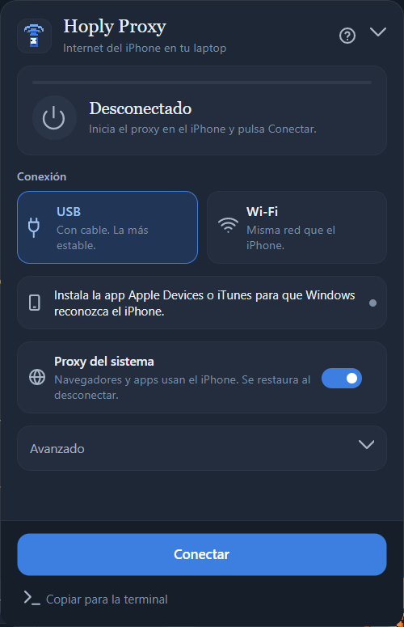

<div align="center">


# Hoply Proxy

**Your iPhone's mobile data, on your laptop. Over a cable or Wi-Fi, in a minute.**

**English** · [Español](README.es.md)


[Download](#download) · [Install](#install) · [Get started](#get-started-in-a-minute) · [Good to know](#good-to-know) · [For developers](#for-developers)

</div>

---

No Wi-Fi at the café, the airport or a client's office? Hoply turns your iPhone into a personal
proxy: plug in your laptop or join over Wi-Fi and browse on your phone's connection. One app on the
iPhone, one on the laptop and a **Connect** button. No jailbreak, no Mac.

## What it does

- 🔌 **Cable or Wi-Fi.** USB for the most stable, private link; Wi-Fi for the freedom to move around
  the room.
- 🖱️ **One click on the laptop.** Hoply Desktop lives next to the clock on Windows, macOS and Linux:
  it connects, turns on the system proxy and puts everything back when you disconnect.
- 🌐 **Everything just works.** HTTP and SOCKS5 on a single port: browsers, terminals, `git`, package
  managers and every system's proxy settings.
- 📈 **Live traffic.** Download and upload speed, data used and connected devices at a glance.
- 🔄 **Heals itself.** When the network changes, Hoply notices and restarts the proxy for you.
- 🌙 **Screen off, still working.** Background mode keeps going with the iPhone locked
  *(experimental)*.
- 🔔 **No surprises.** A reminder before your install expires, so you can renew it in time.
- 🔒 **Secure by default.** Answers only your devices, keeps the password in the Keychain and sends
  traffic out over mobile data only.
- 🧭 **Guides you all the way.** A short setup assistant and full documentation inside the app.
- 🌎 **In your language.** English, Spanish, Portuguese and French: each app follows the system language.

<p align="center">
  
</p>

<p align="center"><code>Laptop ──USB or Wi-Fi──▶ iPhone (Hoply) ──mobile data──▶ Internet</code></p>

## Download

| For | File |
|---|---|
| iPhone (iOS 16 or later) | [Hoply.ipa](https://github.com/darrenarauz21/HoplyProxy/releases/latest/download/Hoply.ipa) |
| Windows 10 and 11 | [Hoply-Desktop-win-x64.zip](https://github.com/darrenarauz21/HoplyProxy/releases/latest/download/Hoply-Desktop-win-x64.zip) |
| macOS with Apple silicon (M1, M2, M3…) | [Hoply-Desktop-osx-arm64.tar.gz](https://github.com/darrenarauz21/HoplyProxy/releases/latest/download/Hoply-Desktop-osx-arm64.tar.gz) |
| macOS with Intel | [Hoply-Desktop-osx-x64.tar.gz](https://github.com/darrenarauz21/HoplyProxy/releases/latest/download/Hoply-Desktop-osx-x64.tar.gz) |
| Linux (x64) | [Hoply-Desktop-linux-x64.tar.gz](https://github.com/darrenarauz21/HoplyProxy/releases/latest/download/Hoply-Desktop-linux-x64.tar.gz) |

The desktop app is a single executable: no .NET, Node.js or anything else to install. Older versions
are in [Releases](https://github.com/darrenarauz21/HoplyProxy/releases).

## Install

**On the iPhone.** All you need is a free Apple ID and [Sideloadly](https://sideloadly.io).

1. Turn on **Developer Mode** in **Settings › Privacy & Security**.
2. Open Sideloadly, connect the iPhone, drag in `Hoply.ipa` and sign in with your Apple ID.
3. In **Settings › General › VPN & Device Management**, trust your developer profile.

With a free Apple ID the install lasts 7 days; to renew it, repeat step 2. Your settings are kept
and Hoply reminds you before it expires.

**🔄 Let it renew itself.** When installing, turn on automatic refresh with the refresh icon at the
bottom left of Sideloadly, and let Sideloadly start with your computer. Whenever the iPhone and the
computer share a Wi-Fi network, it renews a few days before expiry, with nothing for you to do.

**On the laptop.** Unzip the file and open `Hoply`.

- **Windows:** to connect over the cable you need the **Apple Devices** app or iTunes.
- **macOS:** the app isn't signed; the first time, open it with right-click › **Open**.
- **Linux:** make it executable with `chmod +x Hoply` and install the `usbmuxd` package for the
  cable.

## Get started in a minute

1. Open Hoply on the iPhone, follow the assistant and tap **Start proxy**.
2. Open Hoply Desktop on the laptop.
3. Pick **USB** or **Wi-Fi** and click **Connect**. When your public IP shows up, you're browsing
   through the iPhone.

Every detail of the desktop app is in [Docs/escritorio.md](Docs/escritorio.md) (Spanish).

## Good to know

- **Truly private.** Hoply sends no data to any server and never logs the sites you visit.
- **Over the cable, only your laptop.** Over Wi-Fi, only the devices you allow, and it never listens
  on the mobile network.
- **Wi-Fi on trusted networks only.** Traffic between the laptop and the iPhone isn't encrypted.
- **TCP only.** Ping, some games and video calls that rely on UDP may not work.
- **An app ignores the proxy?** The [tun2socks guide](Docs/tun2socks.md) sends all system traffic
  through the iPhone.
- **Rather not install anything on the laptop?** The in-app documentation covers manual setup, and
  the [laptop scripts](Tools/Client) automate it.
- **Check your mobile plan.** Some carriers limit or forbid sharing data.

## For developers

### Build

The iPhone app builds without a Mac: fork the repo, enable **Actions** and run **Build IPA**. The
desktop app needs the [.NET 10 SDK](https://dotnet.microsoft.com/download/dotnet/10.0).

```powershell
git clone https://github.com/darrenarauz21/HoplyProxy.git
cd HoplyProxy
dotnet run --project Desktop/src/Hoply.Desktop     # desktop app
dotnet test Desktop/Hoply.Desktop.slnx             # tests
```

### Layout

```text
App/                      the iPhone app (SwiftUI)
Packages/ProxyCore/       the HTTP and SOCKS5 proxy server
Packages/ProxyConfig/     settings, validation, credentials and guides
Desktop/                  Hoply Desktop (Avalonia) for Windows, macOS and Linux
Tools/                    laptop scripts and the icon generator
```

The [technical documentation](Docs/arquitectura.md) (Spanish) covers the architecture and building
on a Mac.

### Built with

| | |
|---|---|
| iPhone | Swift and SwiftUI, Network.framework |
| Desktop | .NET 10 (C#) and Avalonia 11, the same UI on Windows, macOS and Linux |
| Cable connection | usbmuxd, Apple's service for talking to the iPhone over USB |

## License

Hoply Proxy is source-available, not open source: all rights belong to its author, Darren Araúz.
Under the [PolyForm Noncommercial License 1.0.0](LICENSE) you may use, study, modify and share your
own versions, **for noncommercial purposes only**. Selling it, charging for it or monetizing it in
any way is reserved to its author.

Want to support the project? Contributions are welcome: see [CONTRIBUTING.md](CONTRIBUTING.md).

## Notice

Hoply is an independent project, not affiliated with Apple or any carrier. iPhone, iOS and macOS are
trademarks of Apple Inc.
